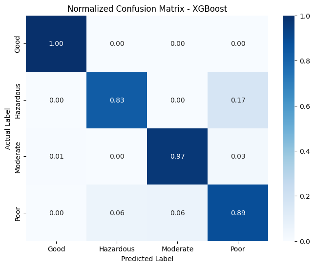
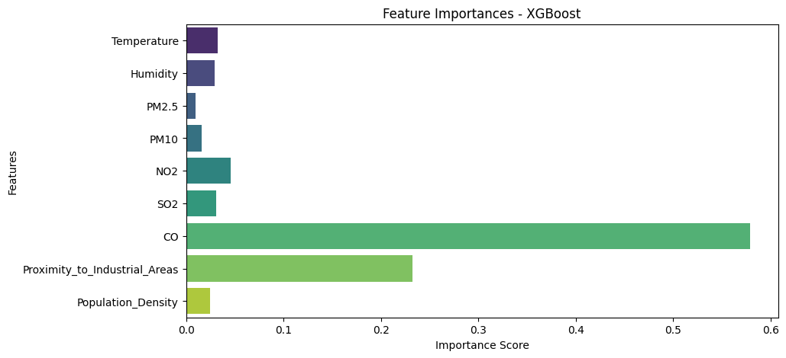

# Predicts Air Quality

A multi-class Machine Learning classifier that predicts an area's **Air Quality** category — **Good**, **Moderate**, **Poor**, or **Hazardous** — from environmental sensor readings and demographic factors.

Developed in Google Colab as part of my AI & Machine Learning internship.

## Objective

- Train and compare baseline classifiers for air-quality categorization.
- Evaluate the selected model with class-balanced metrics, a normalized confusion matrix, and feature importances.
- Provide a reusable inference function that takes a raw sensor reading (a Python dictionary, similar to a JSON payload a backend would receive) and returns the predicted category, a confidence score, and the probability of every class.

## Project Structure

```
Predicts-Air-Quality/
├── README.md
├── Predicts Air Quality.ipynb        # Original Colab notebook (with saved outputs)
├── requirements.txt
├── data/
│   └── updated_pollution_dataset.csv # Dataset used by the notebook
└── outputs/
    ├── evaluation_results.txt        # Printed results copied from the notebook
    ├── confusion_matrix_xgboost.png  # Plot exported from the notebook
    └── feature_importance_xgboost.png
```

## Dataset

- **File:** `data/updated_pollution_dataset.csv`
- **Source:** [Air Quality and Pollution Assessment](https://www.kaggle.com/datasets/mujtabamatin/air-quality-and-pollution-assessment) (Kaggle, uploaded by *mujtabamatin*). Please refer to the Kaggle page for the dataset's license and terms of use.
- **Size:** 5,000 rows × 10 columns, no missing values.

| Column | Type | Description |
|---|---|---|
| `Temperature` | float | Temperature (°C) |
| `Humidity` | float | Relative humidity (%) |
| `PM2.5` | float | Fine particulate matter concentration |
| `PM10` | float | Coarse particulate matter concentration |
| `NO2` | float | Nitrogen dioxide concentration |
| `SO2` | float | Sulfur dioxide concentration |
| `CO` | float | Carbon monoxide concentration |
| `Proximity_to_Industrial_Areas` | float | Distance to the nearest industrial zone (km) |
| `Population_Density` | int | People per km² |
| `Air Quality` | string | **Target** — Good / Moderate / Poor / Hazardous |

Class distribution: Good 2,000 · Moderate 1,500 · Poor 1,000 · Hazardous 500.

## Methodology

### 1. Preprocessing
- Features `X` = all columns except `Air Quality`; target `y` = `Air Quality`.
- The target is encoded with `LabelEncoder` → `{0: Good, 1: Hazardous, 2: Moderate, 3: Poor}`.
- **Stratified 80/20 train-test split** (`random_state=42`) → 4,000 training rows and 1,000 test rows, preserving class proportions.
- Each model is wrapped in a scikit-learn `Pipeline` with `StandardScaler`, so scaling is fitted on the training data only.

### 2. Algorithms
| Model | Settings |
|---|---|
| Logistic Regression | `max_iter=1000`, `random_state=42` |
| Random Forest | `n_estimators=100`, `random_state=42` |
| XGBoost (`XGBClassifier`) | `eval_metric='mlogloss'`, `random_state=42` |

No hyperparameter tuning or cross-validation is performed; all three are baseline models.

### 3. Evaluation
- **Primary metric:** Balanced Accuracy (accounts for the unequal class sizes).
- **XGBoost** is selected for detailed evaluation: classification report (precision, recall, F1), normalized confusion matrix, and feature importances.

## Results

Results below are taken directly from the notebook's saved outputs (test set, 1,000 rows).

**Model comparison — Balanced Accuracy**

| Model | Balanced Accuracy |
|---|---|
| Logistic Regression | 0.8906 |
| Random Forest | 0.9175 |
| **XGBoost** | **0.9204** |

**XGBoost classification report**

| Class | Precision | Recall | F1-score | Support |
|---|---|---|---|---|
| Good | 1.00 | 1.00 | 1.00 | 400 |
| Hazardous | 0.88 | 0.83 | 0.86 | 100 |
| Moderate | 0.96 | 0.97 | 0.96 | 300 |
| Poor | 0.88 | 0.89 | 0.88 | 200 |
| **Accuracy** | | | **0.95** | 1000 |
| Macro avg | 0.93 | 0.92 | 0.92 | 1000 |
| Weighted avg | 0.95 | 0.95 | 0.95 | 1000 |

**Normalized confusion matrix**



"Good" is classified perfectly. Most errors are between the two worst categories: 17% of *Hazardous* samples are predicted as *Poor*.

**Feature importances (XGBoost)**



**CO** is by far the most important feature, followed by **Proximity_to_Industrial_Areas**. The remaining features each contribute much less.

**Inference example** — the sample reading in the notebook (`Temperature 28.5, Humidity 60.2, PM2.5 12.4, PM10 25.1, NO2 20.5, SO2 8.3, CO 1.2, Proximity_to_Industrial_Areas 5.5, Population_Density 450`) is predicted as **Moderate** with a confidence of **0.9996**.

## Inference Function

The notebook defines `predict_air_quality(input_dict, pipeline, encoder)`, which returns:

```python
{
    'predicted_category': 'Moderate',
    'confidence_score': 0.9995...,
    'all_probabilities': {'Good': ..., 'Hazardous': ..., 'Moderate': ..., 'Poor': ...}
}
```

The trained model is kept in memory only — the notebook does not export a model file, so re-run the notebook to recreate it.

## Running the Notebook in Google Colab

1. Open [Google Colab](https://colab.research.google.com/) → **File → Upload notebook** and select `Predicts Air Quality.ipynb` (or open it from GitHub via **File → Open notebook → GitHub**).
2. In the left sidebar, open **Files** and upload `data/updated_pollution_dataset.csv`. The notebook reads it from `/content/updated_pollution_dataset.csv`, which is where Colab places uploaded files.
3. Click **Runtime → Run all**.

All required libraries are preinstalled in Colab. To run locally instead:

```bash
pip install -r requirements.txt
```

Then change the path in the first code cell to `data/updated_pollution_dataset.csv` and run the notebook with Jupyter.

## Dependencies

`pandas`, `numpy`, `scikit-learn`, `xgboost`, `matplotlib`, `seaborn` (see `requirements.txt`).

## Notes and Limitations

- The `use_label_encoder=False` argument passed to `XGBClassifier` is ignored by current XGBoost versions and produces a harmless warning.
- Seaborn shows a `FutureWarning` for using `palette` without `hue` in the feature-importance bar plot; the plot is unaffected.
- XGBoost was chosen for detailed evaluation by design, not through a tuning or cross-validation process. Results come from a single train-test split.
